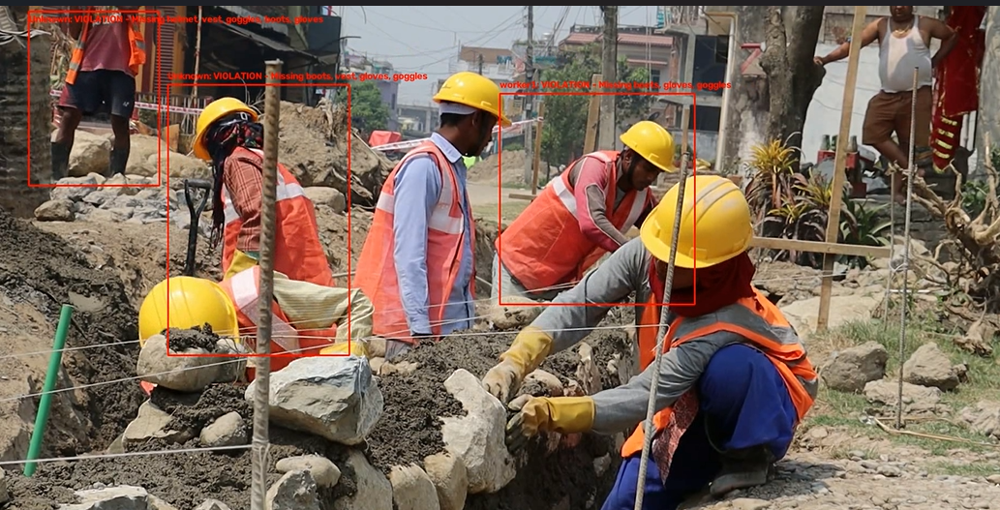
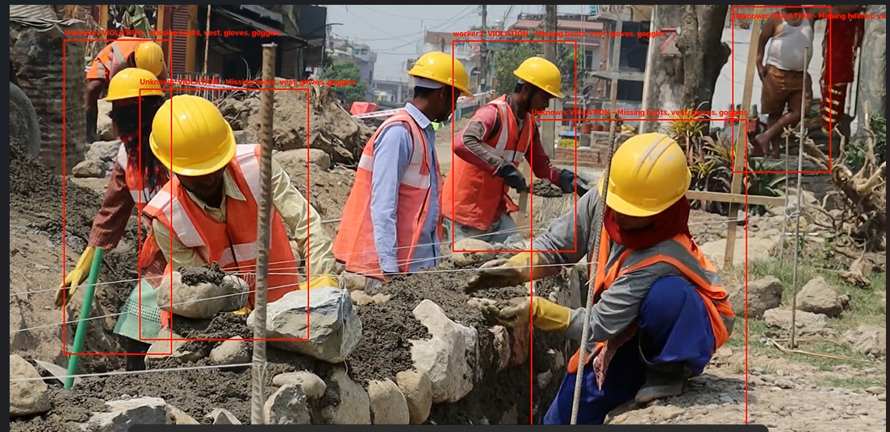

AI-PPE-Safety-Monitor

Create/open README.md and paste this:

# 🦺 AI PPE Safety Monitor

An AI-powered computer vision system that detects workers, identifies registered workers, monitors Personal Protective Equipment (PPE) compliance, and records safety violations automatically.

## 🚀 Features

- 👷 Worker detection using YOLO
- 🆔 Worker identification using face recognition
- 🎯 Multi-worker tracking using ByteTrack
- 🦺 PPE detection
- 🚨 Automatic PPE violation detection
- ⏱️ Prevents repeated violation logging
- 📸 Saves evidence images for violations
- 📄 Stores violation records in CSV
- 📊 Streamlit dashboard for monitoring
- ❓ Unknown-worker detection when a face does not match a registered worker

## 🧠 PPE Classes

The system can detect:

- Helmet
- Gloves
- Vest
- Boots
- Goggles
- No Helmet
- No Gloves
- No Boots
- No Goggles

## 🏗️ System Architecture

```text
Input Video
     ↓
YOLO Object Detection
     ↓
Person + PPE Detection
     ↓
ByteTrack Tracking
     ↓
Face Recognition
     ↓
Worker Identification
     ↓
PPE Compliance Analysis
     ↓
Violation Detection
     ↓
 ┌───────────────┬───────────────┐
 ↓               ↓               ↓
CSV Log     Evidence Image   Dashboard

---
##🛠️ Technologies Used
Technology	Purpose
Python	Main programming language
YOLO	Object and PPE detection
ByteTrack	Worker tracking
DeepFace	Face recognition
OpenCV	Image/video processing
TensorFlow / Keras	Deep learning backend
Pandas	Data processing
Streamlit	Monitoring dashboard

---
## 📁 Project Structure
AI-PPE-Safety-Monitor/
│
├── app.py
├── ppe_monitor.py
├── ppe_compliance.py
├── violation_test.py
├── summary.py
├── requirements.txt
├── README.md
├── .gitignore
│
├── models/
├── faces/
├── test_video/
├── violation_images/
└── violation_log.csv

faces/, violation_images/, videos, trained models, and generated logs are excluded from GitHub using .gitignore.


---
##  Installation

Clone the repository:

git clone https://github.com/YOUR-USERNAME/AI-PPE-Safety-Monitor.git
cd AI-PPE-Safety-Monitor

Create a virtual environment:

python -m venv venv

Activate it on Windows:

venv\Scripts\activate

Install dependencies:

pip install -r requirements.txt


---
#▶️ Running the PPE Monitor
Place your test video inside:

test_video/

Then run:

python ppe_monitor.py

The processed video will be generated as:

ppe_output.mp4

---
#📊 Running the Dashboard

Start Streamlit:

streamlit run app.py

Then open the local URL shown in the terminal.

---
#🆔 Worker Recognition

Registered workers are stored locally as reference images.

For example:

faces/
├── worker1.png
└── worker2.png

If a detected face matches a registered worker within the configured similarity threshold, the worker is identified.

If the similarity is insufficient, the system reports:

Unknown

This prevents unregistered workers from being incorrectly assigned to a known worker.
---
#🚨 Violation Logging

When a worker is missing required PPE, the system records:

Worker name
Missing PPE
Timestamp
Evidence image

Repeated violations are limited using a time-based cooldown to avoid generating hundreds of identical records from consecutive video frames.

---
#📸 Evidence

The system saves images of detected violations in:

violation_images/

Violation information is stored in:

violation_log.csv

These generated files are intentionally excluded from the public repository.
---
#⚠️ Limitations
Face recognition performance depends on image quality and camera angle.
Faces that are too small, blurred, or obstructed may be classified as Unknown.
PPE detection depends on the quality and coverage of the training dataset.
The system currently recognizes only workers whose reference images have been registered.
Performance depends on available CPU/GPU resources.

---
#🔮 Future Improvements
Real-time CCTV camera integration
Database-based worker management
Email/SMS safety alerts
Cloud deployment
Improved face recognition under difficult lighting
More PPE categories
Real-time analytics
Role-based safety monitoring
Automatic safety reports

---
#📌 Project Status

Working Prototype

The current system supports worker detection, tracking, face identification, PPE compliance monitoring, violation logging, evidence generation, and dashboard visualization.
---
## 📸 Demo

### PPE Violation Detection — Worker 1



### PPE Violation Detection — Worker 2


---
👩‍💻 Author

Muskan Meena